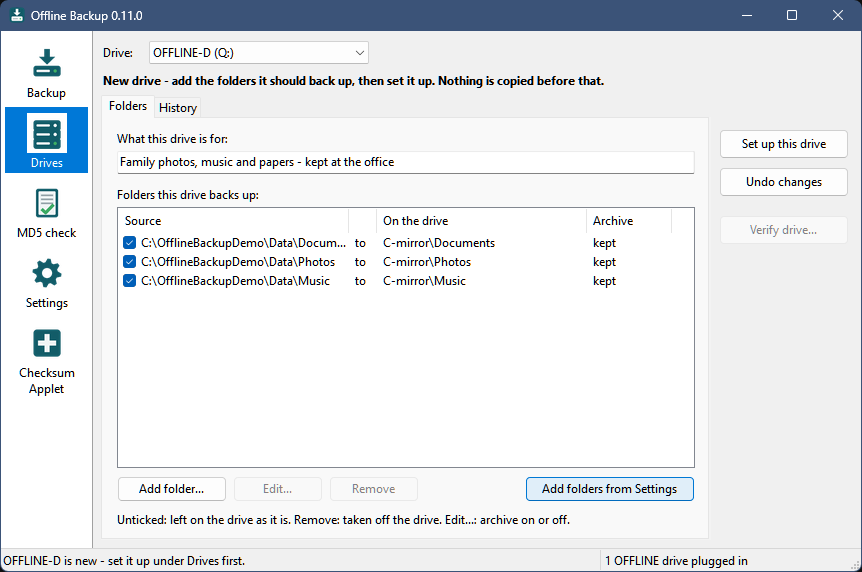
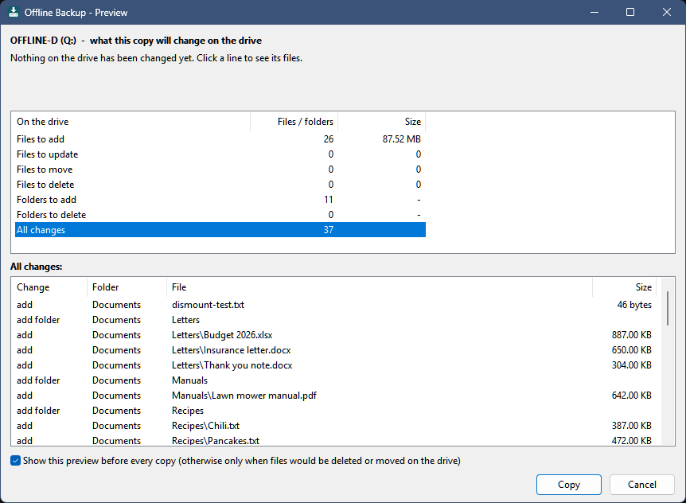
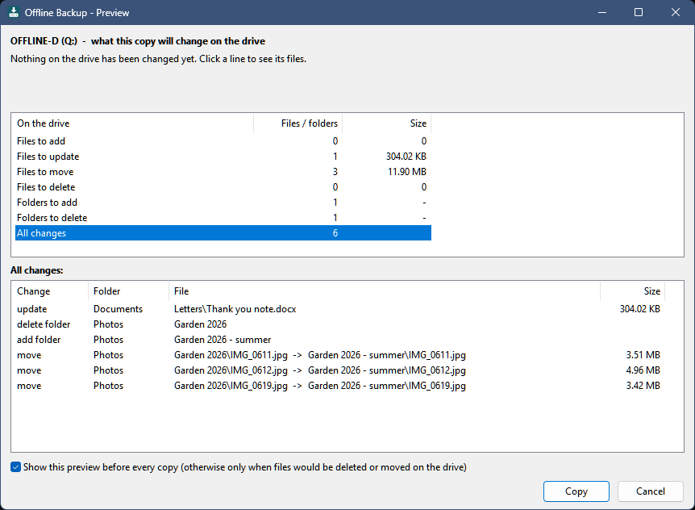
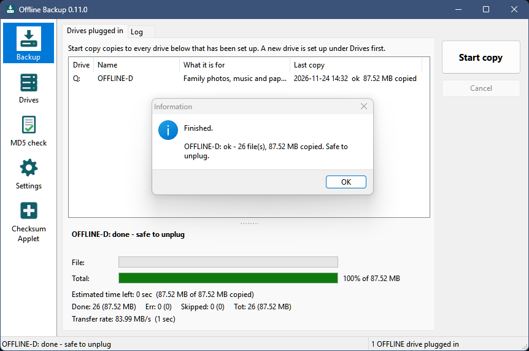
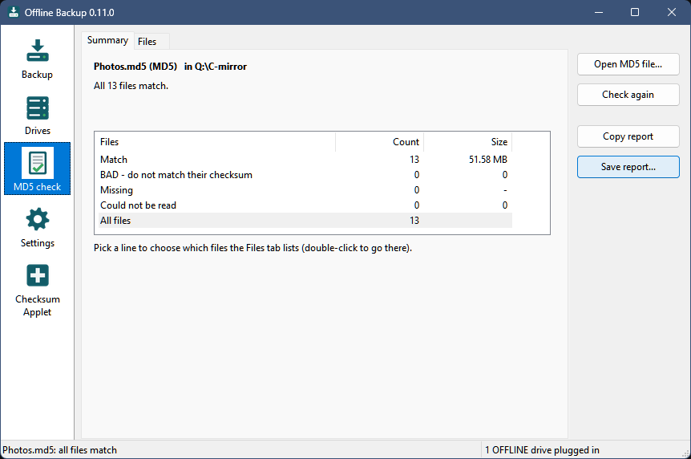
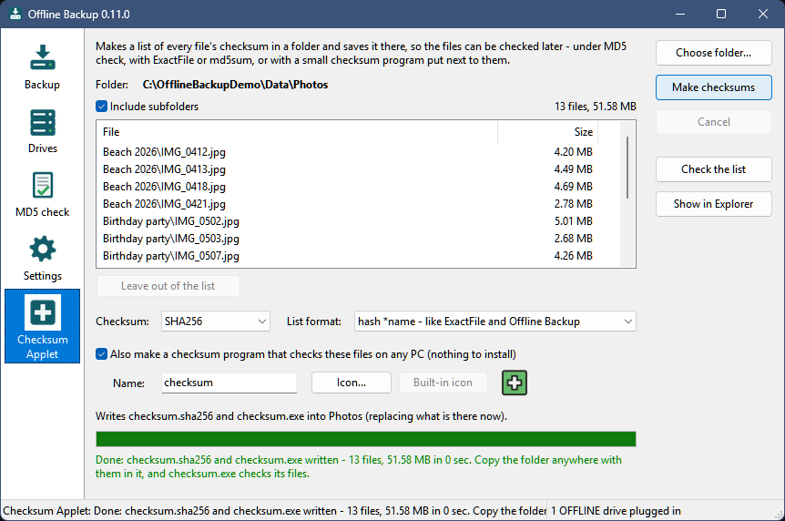
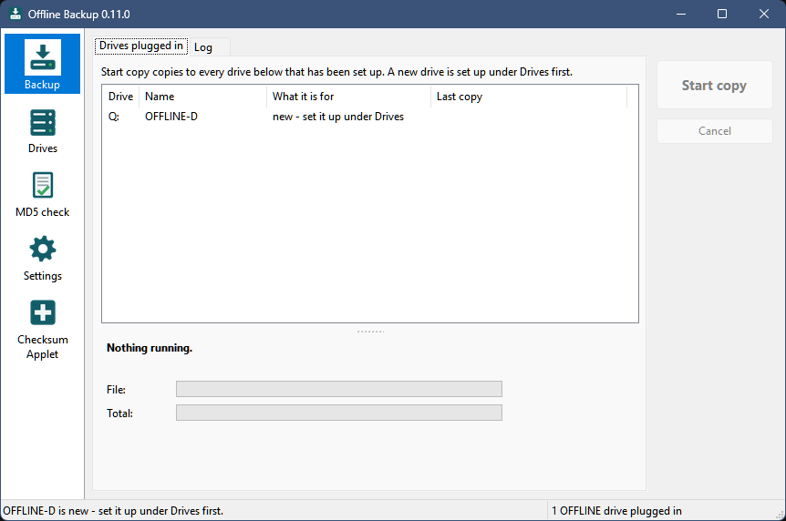
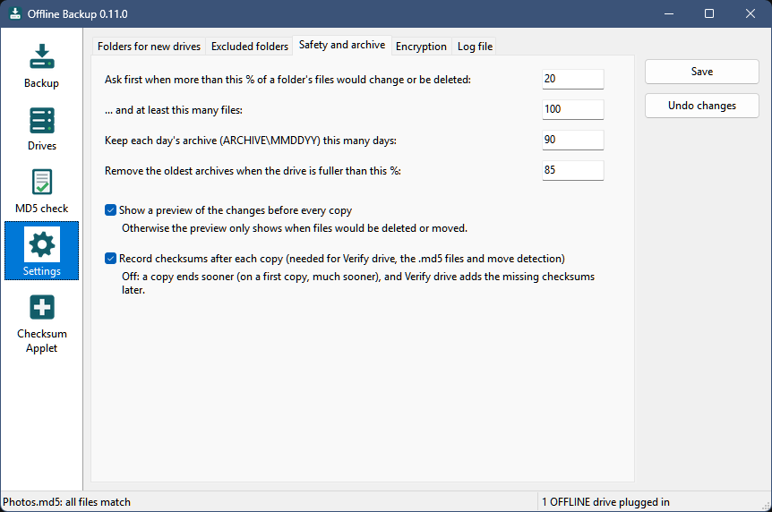

# Offline Backup

A Windows tray app that copies the folders you choose onto USB drives you keep unplugged ("offline") -
labelled `OFFLINE-A`, `OFFLINE-B`, ... - so ransomware, a failed disk or a bad mistake on the PC can't reach
them. Each drive knows which folders it backs up. Before anything changes on a drive you see a preview; files
that would be overwritten or deleted are kept in the day's archive (`ARCHIVE\MMDDYY`) first; moved files are moved on the drive instead
of copied again; and CRC32 / MD5 checksums let you verify a drive at any time, even on another PC.

Version **0.12.0** - public beta. MIT licensed (see `LICENSE`). See `CHANGELOG.md`.

## Download and install

1. Download `OfflineBackup-0.12.0-win64.zip` from the Releases page and unzip it to a folder you can write to
   (for example `Documents\OfflineBackup`).
2. Start `OfflineBackup.exe` - its window opens, and it stays in the tray when you close the window.
   Windows may warn that the program is unknown (it is not code-signed): **More info** > **Run anyway**.
3. Name a USB drive `OFFLINE-A` in File Explorer, plug it in, and set it up under **Drives** (what it is
   for, which folders it backs up). Then **Backup** > **Start copy**.

Needs Windows 10 or 11, 64-bit (robocopy is part of Windows). The zip has a short how-to (`README.txt`).

## Screenshots

**A new drive is set up first:** what it is for and which folders it backs up. Nothing is copied before that.



**A preview before every copy** - nothing on the drive changes until you click Copy:



**Moved and renamed files** are moved on the drive instead of copied again:



**When a run ends**, a small window says how each drive went:



**MD5 check** reads the files back from the drive and checks them against their MD5 checksums:



**Checksum Applet** makes a checksum list for any folder - and, if you like, a small `checksum.exe` that checks
the files on any PC:



<details>
<summary>More: the main window with a new drive, and Settings</summary>





</details>

## How it works

Each folder lands on the drive under its own drive letter: `D:\MUSIC` -> `<drive>\D-mirror\MUSIC`,
`C:\Users\you\Documents` -> `<drive>\C-mirror\Documents`. Files a copy overwrites or deletes are first moved to
the day's **archive** on the drive, `ARCHIVE\MMDDYY` (`ARCHIVE\112326` = 23 Nov 2026), under the same path:
`<drive>\ARCHIVE\112326\C-mirror\Documents\...`. All copies on one day share that folder; a file already archived
that day stays as it was archived first. Every run: a dry run (robocopy `/L`), moved-file detection, the preview
and the safety check, then the old files are archived, robocopy mirrors each folder, checksums are recorded,
archives older than the days set in Settings are removed (sooner if the drive gets full), and `LAST-COPY.txt` and the drive's history are written. The log goes to `offline-copy.log`
next to the settings unless you choose another file.

It comes in two editions built from one shared engine:

| Edition | Folder | Toolchain | Notes |
|---|---|---|---|
| Lazarus LCL | `lazarus\` | Lazarus 4.4 / FPC 3.2.2 | free to build; the published download |
| Delphi VCL | `delphi\` | Delphi 12 (dcc64) | same app, built with Delphi |

Only one of the two can run at a time (they share a single-instance mutex).

## Layout

```
common\
  OfflineEngine.pas    the backup itself: drive detection, settings, drive maps, dry run, moves, preview data,
                       brake, the archive, robocopy with progress, checksums (CRC32/MD5), verify, MD5 check,
                       prune, LAST-COPY.txt, flush. No UI code. Compiles under both compilers
                       ({$mode delphiunicode} under FPC).
  DriveWatcher.pas     WM_DEVICECHANGE via its own hidden window (works the same in VCL and LCL)
  SideBar.pas          the main window's left column of large icon buttons (drawn the same in VCL and LCL)
  Hashes.pas           15 hash algorithms (MD5, SHA1/256/384/512, CRC32, RIPEMD, Tiger, ...) for the Checksums
                       area and the MD5 check of other lists (from the Checksum Applet Creator)
  Digests.pas          checksum list formats: writing them, and reading .md5/.sha1/.sha256/.sfv/BSD-style lists
  Checksums.pas        the Checksum Applet area's work: folder scan, the list, the checksum program, the check report
  HashThreads.pas      reading several files at once: how many (CPU, spinning disk or not) and the workers that
                       share the files out (Windows API only, so the checksum program uses it too)
  ReadingPanel.pas     the files being read right now, under the drive list (drawn the same in VCL and LCL)
  OfflineBackup.ico    app + tray icon (made by tools\make-icon.py)
  icons\               the sidebar's icons (made by tools\make-sidebar-icons.py) and checksum-program.ico
stub\                  CheckStub.dpr - the small checksum program the Checksum Applet area writes (plain Win32, no
                       VCL/LCL); each build.cmd builds it first and the exe keeps it as a resource
delphi\                VCL edition: OfflineBackup.dpr, .rc + manifest, build.cmd, the main window (MainForm),
                       its pages (DrivesPage, CheckPage, SettingsPage, ChecksumsPage - frames) and the pop-ups (PreviewForm,
                       SourceForm), as .pas/.dfm
lazarus\               LCL edition: OfflineBackup.lpi/.lpr, build.cmd, the same forms and pages (.pas/.lfm)
tests\                 EngineTest.dpr - runs the engine against throw-away folders; run-tests.cmd
                       builds and runs it with both compilers
tools\                 make-icon.py, make-sidebar-icons.py, screenshot.ps1, release-readme.txt (the README.txt in
                       the zip)
docs\screenshots\      the README's screenshots (taken with tools\screenshot.ps1 from a demo copy)
make-release.cmd       tests + both builds + the download zip in dist\
build\, dist\          compiler output and release zips (not in git)
```

### Engine / UI split

`TOfflineCopy` (in `OfflineEngine`) does one run against one drive - a copy, a Verify, or an MD5 check - and
reports through events: `OnLog`, `OnProgress`, `OnPreview` (Copy or Cancel), `OnConfirm` (the safety check
when there is no preview) and `OnMissing` (a source folder is gone). `TOfflineCopyThread` runs it in the
background and raises those events on the main thread, so the forms only show things and ask questions.
Everything that decides what happens to a drive is in the shared unit, tested once, for both editions.

Safety rules, enforced in the engine, not the UI:
- only drives labelled `OFFLINE-<A-Z>`, never the drive Windows is on; the label is checked again right
  before copying
- only drives that have been set up and have a folder list
- nothing on the drive is touched until the dry run, the preview and the brake have passed
- anything robocopy would overwrite or delete is moved to the day's archive first (only from inside that
  folder's mirror) - unless the archive is switched off for that folder, which the preview then says
- archive cleanup removes junctions without following them

## Build

```
lazarus\build.cmd       -> build\lazarus\OfflineBackup.exe   (set LAZBUILD if lazbuild.exe is not in F:\lazarus)
delphi\build.cmd        -> build\delphi\OfflineBackup.exe    (Delphi 12 in its default folder)
tests\run-tests.cmd     -> builds and runs the engine tests with both compilers (skips one that is not installed)
make-release.cmd        -> all of the above, then dist\OfflineBackup-<version>-win64.zip
```

Each `build.cmd` first builds the checksum program (`stub\CheckStub.dpr`) with its own compiler into
`build\<edition>\stub\`, then the app, which carries it as the resource `CHECKSTUB`. Building from the Lazarus IDE
alone needs that file to be there, so run `lazarus\build.cmd` once first.

The version is `AppVersion` in `common\OfflineEngine.pas`; keep `delphi\OfflineBackup.rc` and the version
info in `lazarus\OfflineBackup.lpi` in step with it.

Both projects also open in their IDEs. In the Delphi IDE, open `delphi\OfflineBackup.dpr`; the IDE
creates a `.dproj` and may regenerate `OfflineBackup.res` with its own icon. Set the icon to
`common\OfflineBackup.ico` in Project Options, or run `build.cmd` again.

## Use

Start `OfflineBackup.exe`: its window opens, and it also sits in the tray (add `/tray` to start it in the tray
only, for example from a shortcut in the Startup folder). Closing the window keeps it running in the tray. When an
`OFFLINE-x` drive is plugged in while the window is closed, it shows a balloon and opens its window.

The window has a sidebar on the left with one area each - **Backup**, **Drives**, **MD5 check**,
**Settings** and **Checksum Applet** - tabs along the top of each area, the area's buttons on the right, and a status bar at the bottom
(what is happening, and how many OFFLINE drives are plugged in).

**Backup** lists the OFFLINE drives plugged in. **Start copy** copies to every set-up drive among them, one after
another, each with its own folders. Below the list (drag the divider to resize it) the copy shows the file being
copied with a bar of its own, a bar for the whole run, time left, files done / failed / skipped / total and the
transfer rate (also in the tray icon's tooltip); when the run ends, a small window says how each drive went. The
**Log** tab has everything the app did. Closing the window only hides it; **Exit** is on the tray icon's menu.

Changes on the **Drives** and **Settings** pages wait for **Save**; **Undo changes** goes back to what was
saved, and leaving a page with unsaved changes asks first. While a copy runs, every page can be looked at but
not changed.

## Drives

Each OFFLINE drive says for itself what it is for. Its **drive map**, `OFFLINE-BACKUP.ini` at the root, holds:

- a drive id made once at set-up (so two drives with the same label still differ), the label, and what the
  drive is for in your words
- **the folders it backs up**: source folder, name on the drive, ticked or not, archived or not
- folders taken off its list that are still to be archived
- the newest 50 copies to it (when, PC, result, size, folders)

The app keeps a copy of each map in `drives\<id>.ini` next to its settings, so a lost drive still has a record.

A drive is copied to only when it has a map **with a folder list**. A drive without a map is **new**; a map
without a folder list (written before drives had their own lists) counts as "no folders chosen yet". Both show
in the window, Start copy skips them, and the engine refuses them too.

**Drives** (sidebar or tray menu) picks a plugged-in drive at the top and, for that drive, on the **Folders** tab:

- **What this drive is for** - a short description
- **Folders this drive backs up** - `source  to  <letter>-mirror\<name>`. **Add folder...** picks any folder on
  a local drive (not network, not an OFFLINE drive); **Add folders from Settings** adds the folders ticked under
  Settings > Folders for new drives; **Edit...** changes folder or name, and whether the folder is archived.
  - **Unticked**: not updated, its copy stays on the drive as it is.
  - **Remove**: at the next copy (after the dry run and safety check) its copy is moved to
    the day's archive, `ARCHIVE\MMDDYY\<letter>-mirror\<name>`, and cleared out like other archives. Changing a folder's
    path or name does the same for the old copy. A removed folder added back before that copy stays.
  - **Archive** (a column in the list; switched in **Edit...**, on by default): **kept** moves every file
    a copy would overwrite or delete into the day's archive first, as above. **off** lets the copy replace and delete
    that folder's files on the drive straight away - quicker and smaller for folders you don't need history
    of (caches, downloads, build output), but a file that was damaged or deleted on the PC then can't be got
    back from the drive. Switching it off asks first; a preview with such a folder says so in red, and the log
    says how many files were replaced or deleted directly. Kept per drive, in its map (a map written by 0.10
    or older archives every folder).

**Drives used by 0.10 and older** have their old versions in `_versions\<yyyy-mm-dd_hhmm>\`. At the first copy
with 0.11, after the preview, each of those sets is moved into the archive of its day (`_versions\2026-11-20_1500`
-> `ARCHIVE\112026`; when two sets share a day, the earlier copy of a file is kept), and `_versions` goes away
once it is empty. The archives are then cleared out by date like any other.
- **Set up this drive** / **Save** writes the map; nothing else on the drive changes.

The **History** tab lists the copies to the drive, newest first.

When a set-up drive is plugged in, the log shows what it is for, which folders it backs up and how its last
copy went.

### Preview before copying

After the dry run and before anything on the drive changes, a **Preview** window (modelled on ViceVersa's
"Preview: Synchronization") shows per drive: files to add, update and delete, folders to add and delete, and
backup folders being taken off the drive, and **files to move** - with counts and sizes. Clicking a line lists its files (folder, path,
size); "All changes" lists everything. **Copy** goes ahead, **Cancel** leaves the drive untouched ("cancelled at
the preview" in the log). When the safety check would have asked, the preview shows it as a red warning instead.

"Show this preview before every copy" (in the preview and in Settings, on by default): when off, the preview only
appears when something would be deleted or moved on the drive.

**Moved files.** A file moved or renamed inside a backup folder (or a whole folder renamed) is found and shown as
"Files to move" (old path -> new path) instead of one add and one delete: a "new" file counts as a move when a
"deleted" file on the drive has the same size and last-write time, and the new file's CRC32 (and MD5, where
recorded) match the checksum recorded for the drive copy. On Copy it is moved on the drive - instant, nothing copied
again, nothing archived - and its checksum moves with it. Same size and time but other content, or a
changed time, stays add + delete. Files with no checksum yet (copied before checksums were kept) can't be matched
until a Verify has recorded one.

### Checksums and Verify drive

Each copied file's **CRC32 and MD5** are recorded on the drive in `_checksums\<letter>-mirror\<name>.crc` (one
line per file: CRC32, size, last-write time, MD5, path), computed in the same read. The MD5s also go to
`<letter>-mirror\<name>.md5` next to each backup folder - the usual `md5 *path` format (with an ExactFile-style
header), so ExactFile, md5sum and similar tools can check a drive without this app. It is taken from the source right after the copy, and only kept if the
source still has the size and time the drive copy has. Files robocopy deletes leave the list; a removed folder's
list goes with it.

**Verify drive...** (in Drives) reads every file of the drive's folders back from the drive - past the Windows
file cache, so it really is the drive being read - and compares it with its recorded CRC32. It needs nothing from
the PC's folders, so a drive that has sat in a drawer can be checked anywhere. Its progress (Checked / Bad /
New checksums) shows under **Backup**, and it can be cancelled there. Results:

- **ok** - matches.
- **bad** - listed in the log. Its date on the drive is set back to 1990, so the next copy replaces it from the
  source (the bad copy goes to the archive like any other old file).
- **no checksum yet** (copied before checksums existed, or changed since) - its checksum is recorded now and
  checked from the next Verify on.

Each Verify goes into the drive's history ("verified ok", "verify: 2 bad"). Lists from before MD5s were kept get
their MD5s (and their `.md5` file) at the next Verify.

**MD5 check** (sidebar, or Check MD5 file... on the tray menu) checks the files listed in any `.md5` file - one of
the drive's, or one made by ExactFile or md5sum (`md5 *path` and `md5  path` lines, BSD-style `MD5 (path) = md5`
lines; `;` and `#` comments; paths relative to the file's folder). Other checksum lists work the same way:
`.sha1`, `.sha256`, `.sha384`, `.sha512`, `.sfv` (CRC32) and the other algorithms of the **Checksum Applet** area, found
by the file's extension (or an fsum-style `; Algorithm:` line). **Open MD5 file...** starts in the plugged-in drive's mirror folder, where its
`.md5` files are. Progress shows Checked / Bad / Missing under **Backup**; then the page shows how many files
match, are bad, missing or unreadable (**Summary** tab) and which ones (**Files** tab). **Check again** checks the
same file again. **Copy report** and **Save report...** give the result as text, like ExactFile's report: a summary,
the problem files, then every file.

The MD5 check, Verify drive, recording checksums after a copy, the Checksum Applet and its `checksum.exe` read
**several files at once** - as many as the PC has logical processors, less two, at a lower priority so the PC stays
usable - and one at a time on a drive that says it is a spinning disk (where reading several files at once would only
make it seek). Results, logs and reports are in list order either way. While they run, the files being read right
now are listed under the drive list, each with its own bar; the MD5 check's Summary tab then says how long it took
and how fast the files were read.

**Record checksums after each copy** (Settings > Safety and archive, on by default): after a folder is copied, its copied files are read again from the source for their checksums.
On a first copy that is the whole backup, so it takes a while. Switched off, copies end sooner, but the files just
copied have no checksum yet: moves of them aren't detected (they are copied again), they aren't in the `.md5` files,
and Verify drive has nothing to compare them with. The end of the run says so; the next **Verify drive** records
their checksums, so nothing is lost for good.

## Checksum Applet

**Checksum Applet** (the last button in the sidebar) makes a checksum list for any folder, not only backups: choose a
folder (with or without its subfolders), leave out files you don't want listed, pick the **checksum** (MD5,
SHA1, SHA256, SHA384, SHA512, CRC32, Adler32, RIPEMD128/160, Tiger128/160/192, GOST, MD2, MD4) and the **list
format**, then **Make checksums**. The list is saved in that folder as `checksum.md5` (`.sha256`, `.sfv`, ...):

- **hash \*name** - like ExactFile and this app's own `.md5` files; works with every checksum
- **md5sum** / **sha1sum** - for Linux and other GNU tools (forward slashes, LF line ends)
- **SFV** - CRC32, `name CRC` lines
- **FileCheckMD5** - MD5

Tick **Also make a checksum program** and a small `checksum.exe` (about 300-400 KB; the name and its icon can be
changed) goes next to the list. Copy the folder anywhere - another PC, a USB stick, a disc - and double-click it:
it checks every listed file on its own, with nothing installed, and says "Every file is OK" or which files did not
check out, with a report to copy. `checksum.exe /log=report.txt` writes the report and ends (exit code 0 = all
ok, 1 = problems, 3 = stopped), for scripts. Like this app, it is not code-signed, so Windows or a virus scanner
may be wary of it at first.

**Check the list** checks the new list at once on the MD5 check page; **Show in Explorer** shows it. Nothing but
the list and the program is written, and an existing one is only replaced after you say yes. While checksums are
being made, no copy, Verify or MD5 check starts (and the other way round).

## Settings

**Settings** (sidebar or tray menu) holds what is the same for every drive, on five tabs:

- **Folders for new drives** - the folders Drives offers with **Add folders from Settings** when you set up a drive
  (empty at first - you add your own). The name on the drive is the folder's name, with ` (2)`, ` (3)` ...
  if that name is already used on the same drive letter.
- **Excluded folders** - never copied, robocopy `/XD`: a full path, or a name skipped everywhere. `*.partial` is
  always skipped; nothing else is by default. A folder excluded after it was copied stays on the drives as
  it was.
- **Safety and archive** - safety check %, minimum files, days to keep each day's archive, max drive full %,
  whether the preview shows before every copy, and **Record checksums after each copy** (see above).
- **Encryption** - **Dismount VeraCrypt drives after a copy that went well** (off by default; see below), and
  where VeraCrypt was found.
- **Log file** (default: `offline-copy.log` next to the settings file), and where the settings are kept.

Saved as `OfflineBackup.ini` (UTF-8) next to the exe, so the Delphi and Lazarus builds each have their own
(in `%APPDATA%\OfflineBackup\` if the exe's folder can't be written to). No file = the defaults above. If a
ticked folder is missing at copy time, the app asks: skip it (the rest is copied, result and `LAST-COPY.txt`
say INCOMPLETE) or stop that drive's copy.

## Encrypted backup drives with VeraCrypt

A backup drive left in a drawer or a car can be lost or stolen. [VeraCrypt](https://veracrypt.fr) (free, open
source) encrypts it, and Offline Backup works with it: VeraCrypt stays a separate program that opens the drive
and asks for the password - this app never sees the password and never stores it.

**Once, per drive:**

1. Install VeraCrypt from veracrypt.fr.
2. In VeraCrypt, **Create Volume**: either *Encrypt a non-system partition/drive* (the whole USB drive or a
   partition of it - recommended) or a **fixed-size** file container on the drive. File system **NTFS**.
   Not a *dynamic* (sparse) container: it reports its full size even while the drive under it fills up, so the
   app's free-space check and archive cleanup are misled, and a full drive can damage the container.
3. Mount it (pick a drive letter, enter the password), then name the mounted drive `OFFLINE-A` (or B, C ...) in
   File Explorer, and set it up under **Drives** like any other drive.
4. In VeraCrypt, **Tools > Backup Volume Header...** and keep that file somewhere else than on the drive: if the
   start of the drive is ever damaged, it is the only way back in. Keep the password somewhere safe too - not on
   the drive or a note in its box. Without the password nobody, including you, can read the backup.

**Every time:** plug the drive in, mount it in VeraCrypt, **Start copy**. The window marks the drive
`[VeraCrypt]` and shows a **Dismount X:** button. When the copy is done, the app says *dismount, then unplug*
instead of *safe to unplug* - an encrypted drive is only finished once VeraCrypt has dismounted it. Click
**Dismount X:** (or dismount it in VeraCrypt), then unplug. With **Dismount VeraCrypt drives after a copy that
went well** ticked in Settings > Encryption, the app does that itself after each good copy; a copy that failed or was cancelled
leaves the drive mounted so you can look at it.

The app asks VeraCrypt to dismount (`VeraCrypt.exe /dismount X /quit /silent`) and never forces it. If a File
Explorer window or a program still has files open on the drive, VeraCrypt refuses and the app says so - close them
and click Dismount again. VeraCrypt.exe is found through its installer's entry in Windows; for a portable VeraCrypt,
put its path in `OfflineBackup.ini` under `[General]` as `VeraCryptExe=E:\VeraCrypt\VeraCrypt-x64.exe`.

When the whole USB drive or a partition is encrypted, Windows may also give the encrypted partition itself a drive
letter and say it **needs to be formatted**. **Never click Format** - that erases the encrypted backup. Click
Cancel; the backup is reached through the letter VeraCrypt mounts.

## Not done yet

- browse a drive's backups and archives, and restore files (for now: File Explorer - the files on the
  drive are plain copies)
- start with Windows (for now: a shortcut in the Startup folder, `shell:startup`)
- code signing (Windows warns about unsigned programs)

## License

MIT - see `LICENSE`. No warranty: keep more than one backup.
